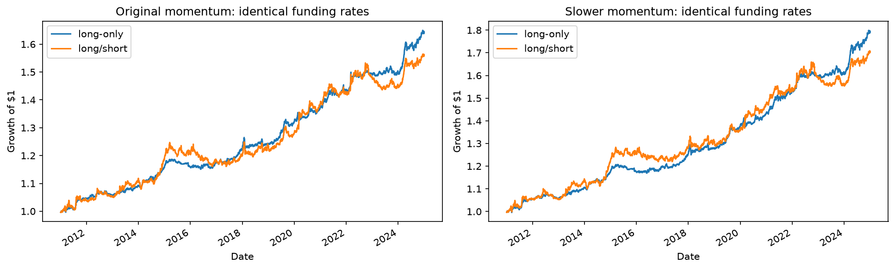
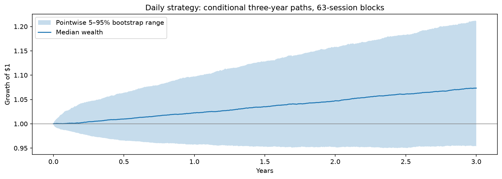

# Multi-Asset Momentum Research

A reproducible Python research project examining how momentum signals, volatility sizing,
rebalancing, execution costs, and shorting affect a six-asset portfolio.

**Main finding:** slower long-only momentum produced a higher historical excess Sharpe and
smaller drawdown than its matched long/short counterpart under the same funding assumptions.
This is a research result, not evidence of a deployable trading edge.

## What I observed

An earlier research project using a cross-sectional mean-reversion signal degraded during
trending regimes. That motivated investigating time-series momentum: each asset's own trailing
return determines its direction, and inverse realized volatility determines its position size.

My initial implementation averaged 21-, 63-, 126-, and 252-session momentum signals. After
adding trading costs, its saved Sharpe fell from approximately **0.77 gross to 0.60 net**.
Annual turnover was about **21.5×**, with roughly **64 basis points** of annual trading fees.

I also found that:

- Scaling each asset with a 10% volatility parameter did not target 10% portfolio volatility.
- Comparing the ensemble against an unscaled single-horizon strategy mixed two changes at once.
- A single historical split and a rolling Sharpe chart did not constitute repeated walk-forward
  model selection.
- Idealized same-close fills and weight-change turnover needed a more explicit execution model.

## What I changed and why

| Observation | Research change | Question tested |
|---|---|---|
| Daily trading incurred meaningful fees | Weekly rebalancing and 1%, 2.5%, and 5% weight bands | Can fewer trades improve net performance? |
| Short-horizon momentum could generate noise | Remove the 21-session component | Does a slower ensemble retain trends with less turnover? |
| Signal and sizing effects were mixed | Add single-horizon, unscaled, and always-long inverse-volatility benchmarks | Which component accounts for performance? |
| Asset scaling did not define portfolio risk | Add covariance-based volatility sizing and exposure caps | What happens when portfolio risk is explicitly budgeted? |
| Fill timing and holdings drift were approximate | Carry dollar holdings and cash; test next-open and next-close execution | Does performance survive executable timing assumptions? |
| Shorting could add fees without useful direction | Compare long-only and long/short momentum with identical funding | Do negative momentum positions actually add value? |
| One realized equity curve hides uncertainty | Add annual walk-forward selection and moving-block bootstrap simulations | How sensitive are results to selection, path ordering, and costs? |

A rebalancing band is an **absolute portfolio-weight gap**, not a percentage price move.
For example, a 2.5% band means a 2.5-percentage-point difference between target and actual
weight. On scheduled trading days, sign changes and exits override the band.

## Results after the changes

Prices cover **2010–2024**. After the 252-session signal warm-up, common evaluation dates are
**2011-01-04 through 2024-12-31**, comprising 3,521 daily observations.

### Structural comparisons

These results include modeled trading fees, exclude funding, and use a **zero risk-free rate**.
All variants below use previous-close signals and next-open execution.

| Strategy | Net Sharpe | CAGR | Maximum drawdown |
|---|---:|---:|---:|
| Daily original ensemble | 0.56 | 2.11% | −9.39% |
| Weekly original ensemble | 0.50 | 1.91% | −8.48% |
| Daily with a 2.5% weight band | 0.61 | 2.33% | −9.07% |
| Daily with a 5% weight band | 0.63 | 2.38% | −9.05% |
| Slower 63/126/252-session ensemble | **0.72** | **2.90%** | **−7.78%** |
| Portfolio volatility targeting, daily | 0.58 | 5.25% | −20.87% |
| Always-long inverse volatility | 0.79 | 3.29% | −9.04% |
| SPY buy and hold | 0.84 | 13.61% | −33.72% |

Weekly rebalancing roughly halved turnover and fees but reduced full-period Sharpe. Slower
momentum and daily weight bands improved historical risk-adjusted performance. Portfolio
volatility targeting mainly increased exposure: its higher return came with a much larger
drawdown. Always-long inverse volatility and SPY remain useful benchmarks; their risk differs.

[Full structural comparison](tsmom_results/10_all_comparisons.csv)

### Does shorting help?

Long-only momentum is different from always-long inverse volatility. It keeps positive momentum
weights, clips negative weights to zero, and leaves the unused capital in cash. The remaining
weights are **not renormalized**.

Both directions use the same fixed annual assumptions: **2% cash interest, 5% debit interest,
and 1% short-borrow fees**. The Sharpe below subtracts a **2% risk-free rate**. These rates are
illustrative scenarios for the entire period, not historical broker quotes.

| Strategy | Excess Sharpe vs 2% RF | CAGR | Maximum drawdown |
|---|---:|---:|---:|
| Original long-only momentum | **0.61** | 3.62% | −3.23% |
| Original long/short momentum | 0.34 | 3.24% | −6.92% |
| Slower long-only momentum | **0.77** | **4.27%** | **−3.42%** |
| Slower long/short momentum | 0.47 | 3.90% | −6.43% |
| Always-long inverse volatility | 0.38 | 3.53% | −8.52% |

Long-only momentum outperformed both matched long/short variants, including when short-borrow
fees were set to zero. Short fees alone therefore did not explain the gap. Removing shorts also
reduced portfolio volatility, so this is not a comparison at equal risk.

**Do not compare the Sharpe numbers across the two tables directly:** funding and the risk-free
assumptions differ.

[Funded results](tsmom_results/06b_funded_long_short.csv) ·
[Borrow-fee sensitivity](tsmom_results/06b_borrow_sensitivity.csv) ·
[Annual direction returns](tsmom_results/06b_direction_annual_returns.csv)



### Validation and simulation

- **Annual walk-forward diagnostics:** select among five fixed candidates on trailing past
  returns, freeze the rule, and test the following year. Annual tests restart from cash and
  include entry and liquidation fees. Across 2016–2024, selected-rule Sharpe was **0.56** versus
  **0.45** for the daily reference using the same annual resets. These runs exclude funding.
- **P&L bootstrap:** 5,000 three-year paths per scenario, using paired gross returns and fees
  from 2020–2024 and moving blocks of 20, 63, or 126 sessions. Cost stresses share random draws.
  With 63-session blocks, daily-rule loss frequency was **16.2%**, increasing to **23.3%** under
  doubled trading fees.
- **Sharpe uncertainty:** resample paths matching the historical evaluation length. For the
  daily rule and 63-session blocks, the descriptive 2.5–97.5% Sharpe range was approximately
  **−0.32 to 1.49**. This is not a significance test adjusted for multiple experiments.
- **Full-rule bootstrap:** jointly resample the six assets' return rows and recompute signals,
  volatility, holdings, and costs. Run 250 paths for each of 126- and 252-session blocks. This
  close-only model uses next-close execution and an explicit warm-up.

[Walk-forward results](tsmom_results/07_walk_forward_performance.csv) ·
[Monte Carlo results](tsmom_results/08_monte_carlo_summary.csv) ·
[Full-rule simulation](tsmom_results/09_full_rule_mc_summary.csv)



## Research workflow

1. Download adjusted OHLC prices, validate the full universe, and cache the dataset locally.
2. Calculate trailing momentum and 63-session annualized volatility using information available
   at each decision close.
3. Build target weights and evaluate every fixed variant on identical dates.
4. Carry actual dollar holdings and cash between trades, including price-driven weight drift.
5. Execute previous-close signals at the next open; apply one-way costs to traded notional.
6. Apply funding scenarios consistently, excluding restricted short proceeds from cash interest.
7. Compare return, volatility, drawdown, turnover, fees, and benchmark performance.
8. Run historical walk-forward selection and dependence-aware simulations.
9. Export configuration, dataset fingerprints, result tables, plots, and an executed notebook.

The notebook is a readable report. Research calculations live in importable modules, so the
same calculations can run from the CLI or from the notebook without copying strategy code.

## Stack and code layout

**Python 3.13**, NumPy, pandas, yfinance, Matplotlib, Jupyter/nbformat/nbclient,
standard-library `unittest`, Ruff, and GitHub Actions.

```text
tsmom/
  config.py        Shared research and funding assumptions
  data.py          Download, validation, cache, and data fingerprint
  signals.py       Momentum direction and volatility sizing
  backtest.py      Holdings, fills, turnover, fees, and financing
  metrics.py       Sharpe, CAGR, volatility, and drawdown
  experiments.py   Fixed structural and direction comparisons
  validation.py    Walk-forward evaluation and bootstrap primitives
  simulation.py    Recorded Monte Carlo experiments
  reporting.py     Figures and notebook presentation
  pipeline.py      Explicit experiment orchestration
tests/
  test_research.py Offline economic and causality checks
run_tsmom_research.py   CLI entry point
tsmom_research.py       Public API compatibility facade
tsmom_strategy.ipynb    Executed research report
tsmom_results/         Selected tables, configurations, and figures
```

The original overlapping test methods were consolidated into eight focused tests covering
execution timing, notional costs, trading schedules, funding, signal causality, metrics,
paired bootstrap scenarios, and past-only walk-forward selection. Tests use synthetic data
and require neither internet access nor Yahoo Finance.

## Reproduce the project

Run these commands from the repository root:

```bash
python3.13 -m venv .venv
source .venv/bin/activate
python -m pip install -r requirements-dev.txt

python -m unittest discover -s tests -v
python -m ruff check .
python -m ruff format --check .

python run_tsmom_research.py
```

The first research run needs internet access to download market data. Subsequent runs use
`.cache/adjusted_ohlc.csv`. Raw market data, personal files, local backups, and bulky individual
simulation draws are excluded from the repository; summary results are committed for review.

```bash
# Refresh the price history explicitly.
python run_tsmom_research.py --refresh-data

# Calculate all experiments and plots without starting a local Jupyter kernel.
python run_tsmom_research.py --no-notebook
```

The second command writes an unexecuted report notebook. The default command also executes
its presentation cells. To inspect the committed report without downloading data, open
`tsmom_strategy.ipynb` directly.

Direct dependency versions are recorded in `requirements.txt`. The dataset checksum and
research settings are saved in `tsmom_results/data_manifest.json` and `research_config.json`.
Yahoo's historical adjustments can change, so a fresh download may not reproduce the exact
committed numbers even with the same code and dependency versions.

## Assumptions and limitations

- This is a six-ETF research universe, not a replication of a diversified futures portfolio.
  Commodity ETFs also reflect their own fund structure and futures roll effects.
- Adjusted OHLC values are total-return proxies, not historical executable quotes. The model
  uses fractional exposures and applies targets to pre-fee equity; fees are debited from cash.
- One-way trading fees are 0.5 bps commission plus asset-specific slippage of 1–5 bps. They are
  assumptions, not measured fills. Market impact, capacity, taxes, and short availability are
  not modeled.
- Funding uses constant scenario rates. Debit interest applies to negative cash, short-borrow
  fees to short notional, and distributions are already included in adjusted returns.
- Volatility and covariance estimates are lagged by execution, but they remain uncertain.
  Target caps are not hard intraday margin controls.
- Many variants were inspected retrospectively. The motivating research included observations
  from 2021–2025, so historical walk-forward results are not claimed as untouched holdouts.
- Bootstrap probabilities assume historical behavior remains relevant. Block boundaries disrupt
  long trends, fee stress on P&L paths does not recompute holdings, and unobserved crises cannot
  be inferred from resampling this dataset.

## Next research steps

Freeze the slower long-only candidate; attribute returns and costs by asset and year; compare
directions at similar risk; use historical cash yields and more realistic financing inputs;
and record forward paper-trading results without continually changing the rules.

## References

- Moskowitz, Ooi, and Pedersen (2012), [Time Series Momentum](https://doi.org/10.1016/j.jfineco.2011.11.003).
- Baltas and Kosowski, [Improving Time-Series Momentum Strategies: The Role of Volatility Estimators and Trading Signals](https://www.cmegroup.com/content/dam/cmegroup/education/files/improving-time-series-momentum-strategies.pdf).
- Politis and Romano (1994), [The Stationary Bootstrap](https://doi.org/10.1080/01621459.1994.10476870).
  This project uses fixed-length moving blocks rather than the stationary bootstrap's random-length blocks.
- Bailey et al., [The Probability of Backtest Overfitting](https://www.davidhbailey.com/dhbpapers/backtest-prob.pdf).
